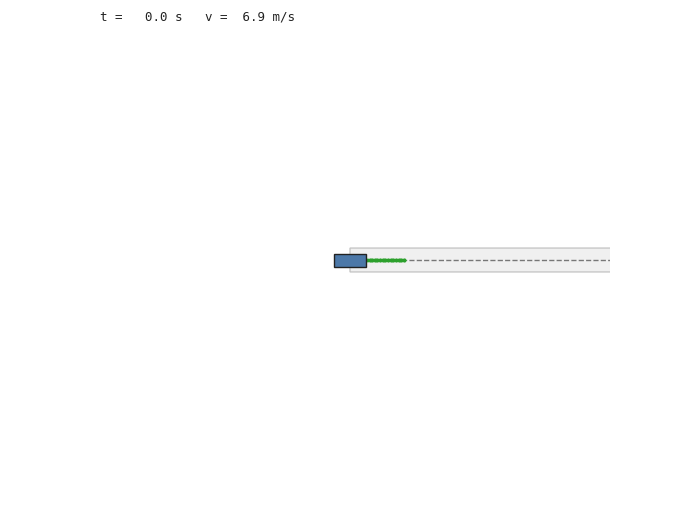
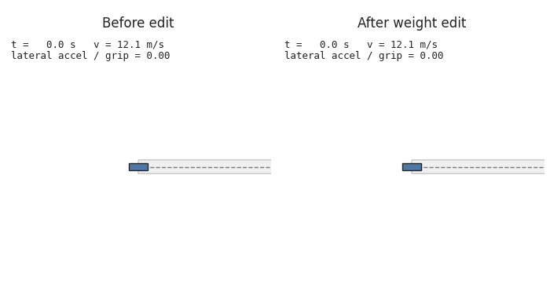
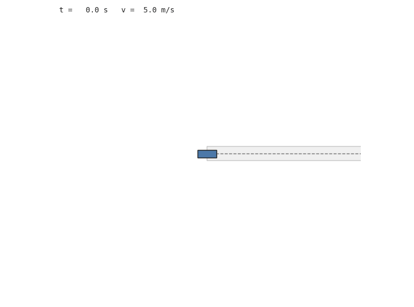
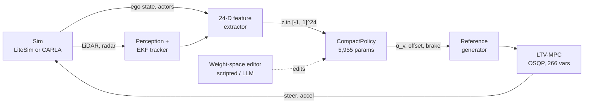

# Hybrid Autonomy: MPC + a 5,955-parameter policy you can edit by hand

[](https://github.com/SAKET-23/carla-sim/actions/workflows/ci.yml)
[](https://github.com/SAKET-23/carla-sim/actions/workflows/ros.yml)

This project combines a hybrid driving stack with an experiment in editing a network's weights directly.

- **The stack.** A small neural policy (24 → 64 → 64 → 3) sets high-level intent: speed scale, lane offset and brake. A linear time-varying MPC tracks the reference and acts as a safety shield, enforcing friction and obstacle constraints.
- **The experiment.** The policy fails on situations it never saw, such as a wet curve or a dense merge. Can a *zero-gradient* edit fix it? That means changing a handful of weights chosen by reading the network, with no retraining.

Everything runs on a laptop CPU in **LiteSim**, a small 2-D simulator written for this project. The same library also drives CARLA 0.9.16 through ROS 2 Humble nodes.

| Nominal driving (green: MPC predicted horizon) | Wet curve: before / after a 5-weight edit |
|---|---|
|  |  |
| Base policy + MPC, completes the route. | Before: enters the low-grip curve too fast and exceeds the grip limit (peak lateral-accel/grip ratio 1.50; the car turns red). After: brakes on the rough-road cue, ratio 0.70. |

**Merge deadlock.** The base policy waits at the junction for a gap that never comes, and the run is flagged as blocked. Playback is time-lapsed after 25 s.



## How it fits together



| Package | What it does |
|---|---|
| `vehicle/` | Dynamic and kinematic bicycle model, blended below 5 m/s; RK4 integration; analytic Jacobians |
| `mpc/` | LTV-MPC: exact ZOH discretisation, slack-softened friction and obstacle constraints, warm-started OSQP |
| `planning/`, `features/` | Routes, reference speed and curvature, the 24-D normalised state, friction estimator |
| `sim/litesim/` | CPU simulator with traffic, lights, friction zones and a rule checker |
| `policy/`, `rl/` | `CompactPolicy`, PPO in a single file, behaviour cloning and DAgger from the MPC expert |
| `weightspace/` | Bundle export, analysis tools, edit-plan schema and validator, the edit loop with acceptance gates; scripted, random and Claude editors |
| `tracking/`, `perception/` | Constant-velocity EKF with radar range-rate fusion; segmentation and 3-D detection backends |
| `sim/carla_backend/` | CARLA 0.9.16 backend: sensors, scenarios, routes, traffic |
| `ros2_ws/` | ROS 2 Humble messages, nodes and launch files; a custom CARLA bridge |
| `infra/runpod/` | GPU pod image (CUDA, ROS 2, Vulkan, CARLA), start/stop scripts, smoke tests |

All the math is in **[EQUATIONS.md](EQUATIONS.md)**.

## Results (LiteSim, 50 development seeds per scenario)

Base policy (behaviour cloning + DAgger):

| Scenario | Driving score | Failure rate | Collisions |
|---|---|---|---|
| nominal | 100.0 | 0.00 | 0 |
| wet curve (μ ≈ 0.35) | 100.0 | 1.00 (lateral-acceleration limit exceeded) | 0 |
| merge deadlock | 49.8 | 0.84 | 0 |

Weight-space edits:

| Scenario | Editor | Result |
|---|---|---|
| wet curve | scripted | **Accepted.** 93 entries changed (5 non-zero), 1.6 % of weights. OOD success 0.875, retention 1.000, no new collisions. A random sparse edit of the same size: 0 of 10 accepted. |
| wet curve | Claude (Sonnet) | Not accepted in 3 runs. It edited the speed output and never used the brake output. |
| merge deadlock | scripted / Claude | Not accepted. Best OOD success 0.55, below the 0.80 bar. |

The accepted edit recruits one hidden unit that fires when road roughness is high and speed is above about 6.5 m/s, and routes it to the brake output. Raw numbers and edit plans are in `results/litesim/`.

## Quick start

Requires Python 3.10 and [uv](https://docs.astral.sh/uv/).

```bash
uv sync --extra dev
CI=1 uv run pytest -q -m "not slow and not gpu"   # fast suite, CPU only

# drive a scenario with the MPC expert
uv run python scripts/run_scenario.py --help

# evaluate the trained base policy
uv run python scripts/eval_policy.py --bench configs/eval/phase3_litesim.yaml \
    --policy results/litesim/phase3/actor_final.pt

# weight-space edit loop: export a failure bundle, then edit
uv run python scripts/export_bundle.py --policy results/litesim/phase3/actor_final.pt \
    --scenario wet_curve --out runs/bundles
uv run python scripts/run_edit_loop.py --bundle runs/bundles/bundle_wet_curve_9c138d3a \
    --editor scripted --out runs/edits/wet_curve_scripted
```

The ROS 2 nodes are tested in a Humble container:

```bash
bash infra/dev/run_ros_tests.sh
```

Training from scratch (about an hour on a laptop):

```bash
uv run python scripts/train_ppo.py --config configs/ppo/litesim_dagger_base.yaml \
    --envs 8 --bc-steps 300000 --dagger-rounds 8 --dagger-steps 100000 --total-steps 0 --launch-weight 1
```

## Status

- **Done and tested on CPU:** vehicle model and MPC, LiteSim and scenarios, policy training, the weight-space pipeline, tracking, ROS 2 packages (in-process vs ROS parity to 1e-6), the CARLA backend (against a mocked CARLA API) and the pod image build.
- **Not yet run:** anything that needs a GPU, which means CARLA itself, perception training and TensorRT engines. The CARLA backend is written against the API docs and is unverified until then.

## License

No license file yet; all rights reserved by the author.
