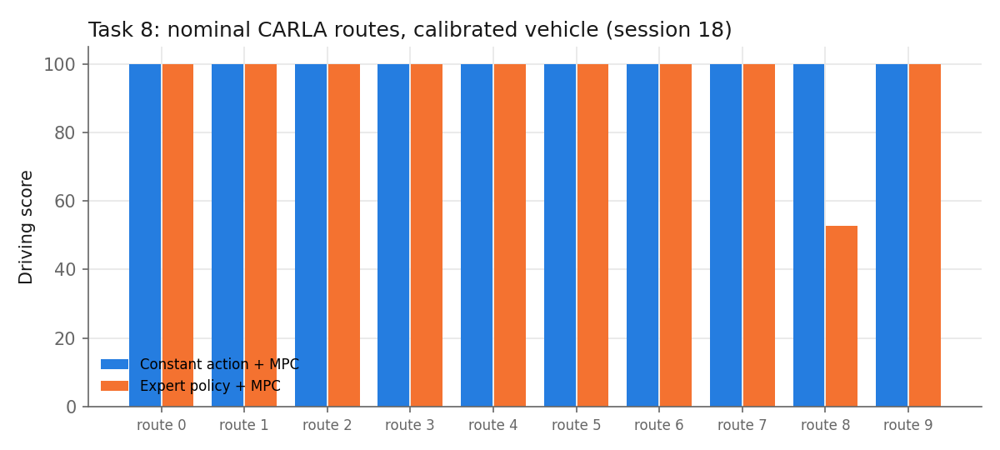
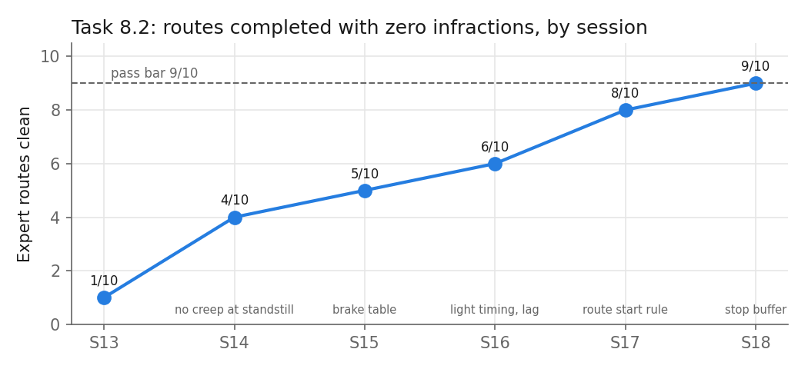
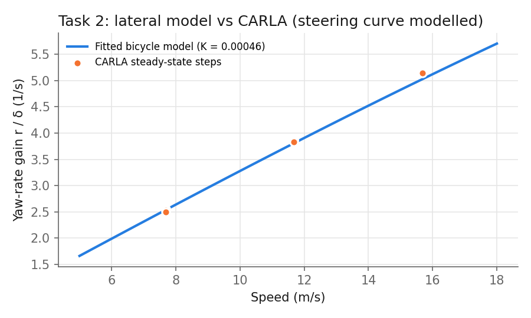
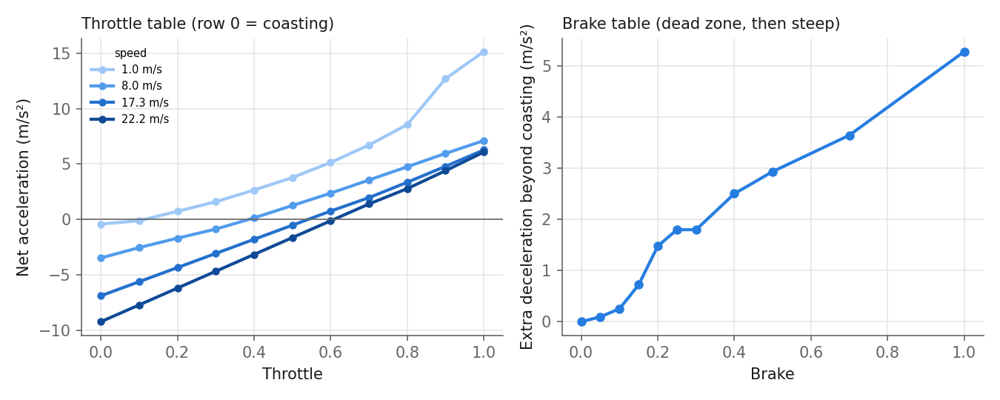

# CARLA results (RunPod)

These are results from the phases that run on a rented GPU, all with CARLA 0.9.16 in synchronous mode (dt 0.05 s). Pods run on RunPod Secure, an RTX 4000 Ada with 20 GB VRAM and 16–18 vCPU at $0.28/h. The raw outputs are in each phase folder.

| Phase | Status | Folder |
|---|---|---|
| G1 pod bring-up | Done (GO) | [`g1/`](g1/) |
| G2 integration check and calibration | Done, with logged gaps | [`g2/`](g2/), final runs in [`g2/final/`](g2/final/) |

## G1: pod bring-up (2026-11-27, pod time 2.1 h)

Verdict: **GO**. Full summary: [`g1/g1_summary.md`](g1/g1_summary.md).

- **Vulkan works:** headless CARLA renders with Vulkan on a RunPod pod once `NVIDIA_DRIVER_CAPABILITIES=all` is set. Smoke tests 01–04 pass, and [`g1/smoke04.png`](g1/smoke04.png) is a real rendered camera frame.
- **Full `Town03` crashes:** CARLA 0.9.16 segfaults on `load_world` every time on this pod. `Town03_Opt` has the same road network and loads fine, so it is now the default everywhere.
- **Python path fix needed:** the ROS 2 nodes run on the system Python and need the repo source plus the venv packages on `PYTHONPATH`. The pod setup now adds them.
- **Full sensor rig through ROS is slow:** about 1.6–1.8 ticks/s at both Low and Epic quality (target 20). G2 Task 0b looked for the cause.
- **Pinned dependencies:** the versions that were checked are in [`g1/pins.txt`](g1/pins.txt).

## G2: integration check and calibration

### Task 0: steady-state tracking metrics (Mac, done)

`eval/metrics.py::steady_state_mask` drops four kinds of steps from the tracking metrics:
- the first 5 s;
- junction windows, from 5 m before entry to 5 m after exit;
- steps with `brake_flag ≥ 0.5`;
- steps where the MPC fell back to its backup command.

`run_scenario.py` now also writes `cross_track_rmse_ss`, `heading_rmse_deg_ss`, `steering_jerk_rms_ss` and `mask_fraction`. The jerk is computed only over continuous runs of kept steps, so a masked gap doesn't create a fake spike.

### Task 0b: where does the time go? ([`g2/0b_tick_profile/`](g2/0b_tick_profile/tick_profile.csv))

Town03_Opt at Low quality, with the sensors driven through the ROS bridge:

| Sensors | Ticks/s | CARLA cores | Bridge cores | Pod cores |
|---|---|---|---|---|
| none, no rendering (the PPO setup) | **201.7** | 1.45 | 1.01 | 2.90 |
| 2 cameras (RGB + semantic, 1280×720) | **2.2** | 1.42 | 0.87 | 2.35 |
| + LiDAR | 1.77 | 1.76 | 0.90 | 2.72 |
| full rig (+ radars, IMU) | 1.78 | 1.77 | 0.90 | 2.74 |
| full, LiDAR at 32 channels / 600k points/s | 1.97 | 1.63 | 0.89 | 2.61 |

The cameras cause almost all of the slowdown, and the CPU and GPU are both mostly idle. More vCPUs or a bigger GPU would not help.

### Session 1 (2026-11-28, pod time 1.4 h, three CARLA servers in parallel)

Step outcomes are in [`g2/session1/status.tsv`](g2/session1/status.tsv), and test results in [`g2/session1/ic_junit.xml`](g2/session1/ic_junit.xml).

**Camera size.** These runs went through the ROS bridge, with GPU load recorded ([`camera/tick_profile.csv`](g2/session1/camera/tick_profile.csv)):

| Cameras | Ticks/s | GPU load |
|---|---|---|
| 2 × 1280×720 | 2.1 | 11 % |
| 1 × 1280×720 (RGB only) | 3.1 | 9 % |
| 2 × 960×540 | 3.2 | 16 % |
| 2 × 640×360 | 4.8 | 20 % |

**IC-40, tick rate run inside our own code, without ROS** ([`ic40/vram.csv`](g2/session1/ic40/vram.csv)):
- mode A (no rendering, no sensors): **37.1 ticks/s, PASS** (target ≥ 20);
- mode C (full rig): **7.95 ticks/s**.

Through the ROS bridge, the same full rig runs at about 2 ticks/s. So the bridge's handling of sensor messages, not CARLA's rendering, is the main cost with cameras on. The GPU stays under 20 % busy at every camera size.

**IC-39, MPC solve time on the pod CPU, measured alone** ([`mpc/bench_circle.txt`](g2/session1/mpc/bench_circle.txt)): p50 16.0 ms, p99 20.5 ms. **FAIL** against the targets of 10 ms and 20 ms. To be tuned in Task 6.

**Bugs found and fixed (in commit order on `main`):**

| Item | What happened on real CARLA | Fix |
|---|---|---|
| Map fixture | `find_map_features.py` called `world.get_traffic_lights()`, which 0.9.16 doesn't have. With no fixture, 29 integration tests skipped and the vehicle, throttle/brake and tyre-grip calibrations could not run. | Find lights with `world.get_actors().filter("traffic.traffic_light*")`, and print each curve once (`11e1b3e`) |
| IC-17 route heading | The route's heading jumped by π (assert `3.14159 < 0.3`). The planner returned waypoints behind the start, so the path doubled back. | Drop waypoints that lie behind the previous one (`c230807`) |
| IC-37 first drive | The route planner snapped the start onto a crossing road about 8 m away. The car started 90° off the route, went to full steering lock and stopped (completion 0, cross-track 8.7 m). The log also printed the goal under the label "spawn point". | Reject any route whose first waypoint is more than 5 m from the spawn, and fix the log line (`c230807`) |
| Seeds | The integration tests used benchmark seed 100000, and G2 must use only training seeds. | Use seed 0 (`26c5a1b`) |

**Map scan ([`map/`](g2/session1/map/)).**
- Curves with a radius of 28–35 m exist only in Town03_Opt: R 30.5 m over a 57° arc, and R 32.6 m over an 80° arc.
- Junctions with three roads and no traffic lights were found in Town03_Opt and Town04, and none in Town01, Town02 or Town05.
- Town03_Opt is therefore the candidate for the wet curve (R 32.6 m) and the merge (junction 1932). This departs from the plan's town rule and is logged.

**Tooling added for session 2:**
- `scripts/pick_routes.py`: picks 300–800 m routes with no lane change (10 training, 10 Town10HD);
- route sets in `carla_routes.yaml`: entry `seed % 10`, plus `--route-set` / `--route-index`;
- `CARLA_PORT` / `CARLA_TM_PORT` environment variables, so several CARLA servers can share one pod.

### Sessions 2–19 (2026-11-28/29, pod `carla-g2-migration`, 11.8 h, about $3.30)

Each session ran up to five CARLA servers in parallel on one pod (one server per port). The raw outputs stayed on the pod and the Mac; the final runs, charts and calibration files are in [`g2/final/`](g2/final/). Every number below comes from those files.

#### Result by task

| Task | Result | Pass bar |
|---|---|---|
| 1 Integration items | route 4/4, infractions 8/8, determinism, client, convert, sensors, friction, parity all pass. `features` passes every truth comparison and fails only its range check: `target_curvature` reaches −0.178 1/m on Town01 corners, outside its ±0.1 range | all pass |
| 2 Lateral vehicle model | held-out yaw-rate RMSE **0.0028 rad/s**, lateral-speed RMSE 0.045 m/s, steady-state gain error **3.0 %** | < 0.02 rad/s, < 0.1 m/s, < 10 % |
| 3 Longitudinal map | throttle table R² **0.941**, coasting damping 0.42 1/s, max deceleration 9.34 m/s² | R² ≥ 0.9 |
| 4 Wet-curve friction | tyre-friction scale **k\* = 0.1127** gives 3.34 m/s² (0.34 g for the 0.35 target), repeats ±0.1 %; IC-23 wet 3.34 vs dry 9.04 m/s² | wet ≤ 0.6 × dry |
| 5 Sensor frames | IC-05, IC-13, IC-16 pass | pass |
| 6 MPC tracking (5 seeds) | cross-track **0.001–0.052 m**, 0 fallbacks; heading **0.04–1.42°** on 4 seeds, **1.74°** on seed 3; steering jerk 17–110 rad/s³ | < 0.12 m, < 1.5°, jerk < 0.5 (may miss, reported) |
| 7 Layouts | wet curve, merge deadlock and Town10HD all complete with driving score 100 | complete |
| 8.1 Constant action + MPC, 10 routes | **10/10** complete, no collision | ≥ 9/10 |
| 8.2 Expert + MPC, 10 routes | **9/10** complete with zero infractions | ≥ 9/10 |
| 8.3 Phase 3 policy in CARLA | not run: `run_scenario` has no policy source yet | no bar |
| 9 ROS graph | parity with the in-process stack passes; the ground-truth ROS episode runs at about 1–2 ticks/s | parity |
| 10 Latency | 10 late policy commands in 1200 ticks; a 2000-tick run did not finish in 30 min | measured |

The MPC solve time is **15.1 ms at p50** on the pod CPU (target 10 ms), measured with BLAS pinned to one thread. It is a real miss, not a measurement artefact.

#### Calibration

The calibrated files are committed: [`configs/vehicle/carla_model3.yaml`](../../configs/vehicle/carla_model3.yaml), [`configs/vehicle/carla_model3_longitudinal.yaml`](../../configs/vehicle/carla_model3_longitudinal.yaml) and `carla_tire_friction_scale` in [`configs/scenarios/wet_curve.yaml`](../../configs/scenarios/wet_curve.yaml).

- **Steering.** CARLA turns the front wheels less as speed rises (its `steering_curve`: 0.9 at 20 km/h, 0.8 at 60 km/h). Ignoring it left a 12 % gain error at 16 m/s. With the curve in the model and in the actuation, the car is close to neutral steer (K = 0.00046) and matches the bicycle model within 3 % from 8 to 16 m/s.
- **Throttle.** Released throttle decelerates the model3 at about 0.42 × speed (regenerative braking), not rolling resistance plus drag. The map is therefore a table of net acceleration over speed and throttle, with a coasting row.
- **Brake.** Brake below about 0.1 does almost nothing, then deceleration rises steeply. A linear brake law asked for brake inside that dead zone and the car overran stop lines; the map now has a brake table.

#### Bugs found on real CARLA and fixed

| What happened | Fix |
|---|---|
| The first vehicle identification wrote a rolling resistance of 92 m/s²: the reset sets the start speed in one tick, so `get_acceleration` spiked to v0/dt. Every later run held full throttle and crashed | hold the start speed for 1.5 s before recording; refuse to write a calibration that fails its gates |
| numpy's BLAS sized its thread pool to the host's 128 cores, not the pod's 13.6-core quota: about 250 spinning threads per process | `OMP_NUM_THREADS=1` (and OpenBLAS, MKL) in the pod environment |
| Timed-out `ros2 launch` runs left their nodes running; they would join the next ROS graph | kill leftover nodes before and after each ROS step |
| Lateral identification steps reached 8.5 m/s² and ran off the city road | size steps by lateral acceleration (1–3 m/s²); unload building and prop layers while identifying; drop segments that collide or never settle |
| The car crept over stop lines at 0.09 m/s: the throttle table held coasting deceleration constant down to standstill | coasting goes to zero at standstill; no throttle below coasting; brake hold when stopped |
| Red lights lasted 26 s instead of 10 s: CARLA cycles each light in a group through green, yellow and its own red | set every light in the group so the ego light's red matches the scenario cycle |
| Stops came 2–3 m late: the drivetrain and brake respond in 0.3–0.5 s | `actuator_lag` in the stopping profile (CARLA reference config: 1.0 s) |
| Routes started 1.5–6.5 m before a red stop line at 5–6 m/s | the route picker rejects starts within 30 m of a light's stop line |
| The steady-state tracking metric used the LiteSim route's junctions, not the CARLA route's | use the CARLA route's own junction intervals |
| Integration-test bugs: hard-coded port 2000, straight-line instead of along-route stop distance, a fixed-steer test driver on curved routes, the wrong town for a route | fixed in the tests |

#### Open findings, carried forward

1. **MPC obstacle constraint can dodge instead of brake.** On expert route 8 a crossing car with green passed about 4 m ahead while the ego slowed for its red light. The obstacle half-plane went into slack and the MPC chose full throttle and full left lock, leaving the lane by 2.7 m. The half-plane normal comes from the warm-started straight plan, which runs through the crossing car's path. It happened in 1 of 20 runs; it must be fixed before G4.
2. **MPC solve time** 15 ms at p50 against the 10 ms target.
3. **`target_curvature` range** ±0.1 1/m is too small for Town01's tight corners (−0.178). Not changed, because the trained policy depends on the feature ranges.
4. **Task 6 heading on seed 3** is 1.74° against 1.5°; steering jerk misses its 0.5 rad/s³ target on every seed.
5. **ROS bridge throughput** stays at 1–2 ticks/s with the full sensor rig (see Task 0b).
6. **Task 8.3** needs a policy source in `run_scenario`.
